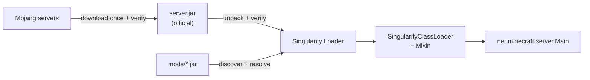

<div align="center">

# Singularity Loader

**A mod loader for Minecraft servers, built on Mixin.**
Drop in mods, patch the game with Mixin, keep the official `server.jar` untouched.

[](LICENSE)


</div>

---

## Features

- **Fetches the official server for you.** On first start the loader downloads Mojang's server jar into `.Singularity/VanillaServerJars/` (looked up through Mojang's own version manifest, verified with SHA-1), then unpacks and runs it. Nothing is redistributed and the jar is never modified. Already have a server? It works with that too.
- **Mixin built in.** [Mixin](https://github.com/FabricMC/Mixin) (0.17.2) and [MixinExtras](https://github.com/LlamaLad7/MixinExtras) (0.5.5) patch Minecraft's classes as they load, on Java 25.
- **No mappings.** Minecraft 26.x ships unobfuscated, so mods use the real class and method names. Every unobfuscated release is supported, 26.1 to 26.3.
- **Simple mod format.** One `singularity.mod.json` with entrypoints, Mixin configs and dependencies.
- **Plugins and the Singularity API (4.0).** Plugins in `SingularityPlugins/` with a `plugin.toml`, commands, events, a scheduler and TOML configs, compiled without Minecraft or Mixin. Mods get the same API. Positions are 64-bit. See [`docs/PLUGIN_DEVELOPMENT.md`](docs/PLUGIN_DEVELOPMENT.md).
- **Built for many players on weak hardware (4.2).** The server lowers view and simulation distance, mob spawning and far-away mob ticking by itself when ticks get slow, and goes back up when the load is gone; entity tracking and chunk unloading no longer collapse under load. 50 test players on 2 CPU threads: 4 TPS without, 19 TPS with it. See [`docs/PERFORMANCE.md`](docs/PERFORMANCE.md).
- **Real dependency handling.** `depends`, `breaks`, `recommends`, `conflicts`, `suggests`, semantic version ranges (`^1.2`, `>=1.0 <2`, `1.x`, ...) and a deterministic load order.
- **Errors you can act on.** Every problem with your mods is reported at once, in plain language. No stack traces for things you can fix.
- **Debug tools.** `--singularity-debug` for verbose logs, `--singularity-dump` to inspect every class Mixin changed.
- **Small and readable.** A few thousand lines of Java, documented, unit tested.

| | Server | Client |
|---|---|---|
| Singularity Loader 0.1 | supported | planned |

## Quick start (server owners)

**Supported Minecraft versions: 26.1, 26.1.1, 26.1.2, 26.2 and 26.3**, every release Mojang ships unobfuscated (pick one with `--singularity-game-version=<id>`; use one server folder per version). One loader jar, one API mod jar and the same plugins work on all of them; see [`docs/VERSIONS.md`](docs/VERSIONS.md).

**You need:** JDK **25** (Minecraft 26.x requires it) and an internet connection for the first start.

1. Download the Singularity Loader release (`singularity-loader-<version>.zip`) and unpack it. Keep its files together: the jar needs the `lib` folder next to it.
2. Make a server folder and accept the [Minecraft EULA](https://aka.ms/MinecraftEULA) as usual (`eula.txt`).
3. Start the loader **from the server folder**:

   ```sh
   # Linux / macOS
   /path/to/singularity-loader/start.sh nogui
   # Windows
   C:\path\to\singularity-loader\start.bat nogui
   # or directly (JVM options go before -jar)
   java -Xmx4G -jar /path/to/singularity-loader/singularity-loader.jar nogui
   ```

   The first start downloads Minecraft 26.3 (about 60 MB for the server and its libraries). Later starts need no internet.
4. Drop mod jars into the `SingularityMods` folder (created automatically).
5. For plugins: put `singularity-api-<version>.jar` (the Singularity API mod) into `SingularityMods` and the plugin jars into `SingularityPlugins`. `/plugins` lists them.

You should see the Singularity banner, then framed log entries and a single animated loading bar (`| / — \`) while the game is unpacked, then the EULA question (answer `yes`/`no`; it is saved in `ServerEula.txt`) and `Starting Minecraft Via net.minecraft.server.Main.`

Your server folder afterwards:

```
server/
├── .Singularity/
│   ├── VanillaServerJars/Vanilla-Server-26.3.jar   Mojang's official server (downloaded, hash-checked)
│   └── ProcessedMods/                              reserved for processed mods
├── GameLibraries/      Minecraft's libraries (unpacked)
├── GameVersions/       the Minecraft game jar (unpacked)
├── ServerLogs/Latest.log
├── SingularityMods/    your mods
├── SingularityPlugins/ plugins (loaded by the Singularity API mod)
├── ServerEula.txt      EULA answer
└── ServerConfig.toml   all server settings (replaces server.properties)
```

**Already have a server?** If you start with `--singularity-server-jar=<path>` that jar is used instead of a download. If the download is impossible (no internet) the loader falls back to a `server.jar` or an unpacked `versions/<id>/server-<id>.jar` in the folder.

### Command line

Everything that is not a loader option is passed to Minecraft (`nogui`, `--port 25566`, ...).

| Option | Description |
|---|---|
| `--singularity-game-version=<id>` | Minecraft version to download and run (default `26.3`; `latest` = newest release) |
| `--singularity-server-jar=<path>` | Use this server jar instead of downloading one |
| `--singularity-server-url=<url>` | Download the server jar from this URL (Mojang `.../v1/objects/<sha1>/server.jar` URLs are hash-verified) |
| `--singularity-offline` | Never use the network; needs a cached or provided server jar |
| `--singularity-setup` | Download and unpack the game, print the `minecraftDir=` folder for mod projects, then exit |
| `--singularity-mods-dir=<path>` | Use a different mods folder (default `./mods`) |
| `--singularity-add-mod=<path>` | Load an extra mod jar or directory; repeatable (development) |
| `--singularity-debug` | Verbose logging |
| `--singularity-dump` | Write every class changed by Mixin to `.singularity/dump/` |
| `--singularity-version` / `--singularity-help` | Print version / help |

System properties: `-Dsingularity.debug=true`, `-Dsingularity.serverJar=<path>`, `-Dsingularity.addMods=<path>[:<path>]`, `-Dsingularity.manifestUrl=<url>` (mirror of Mojang's version manifest).

## Writing a mod

```json
{
  "id": "hello",
  "version": "1.0.0",
  "environment": "server",
  "entrypoints": { "main": ["com.example.Hello"] },
  "mixins": ["hello.mixins.json"],
  "depends": { "minecraft": ">=26.1" }
}
```

```java
public final class Hello implements ModInitializer {
    @Override public void onInitialize() {
        System.out.println("Hello from " + SingularityLoader.getInstance().getGameVersion());
    }
}
```

```java
@Mixin(targets = "net.minecraft.server.dedicated.DedicatedServer")
abstract class DedicatedServerMixin {
    @Inject(method = "initServer", at = @At("HEAD"))
    private void onInit(CallbackInfoReturnable<Boolean> cir) { /* runs when the server starts loading */ }
}
```

**Starting a new mod?** Use the *Singularity Example Mod* template (the Singularity version of Fabric's example mod): open it in IntelliJ, let Gradle sync (it downloads Minecraft for you), build.

The full guide (metadata reference, version ranges, entrypoints, Mixin tips, Gradle setup) is in
[`docs/MOD_DEVELOPMENT.md`](docs/MOD_DEVELOPMENT.md), and [`example-mod/`](example-mod) is a working project.

## Writing a plugin

```toml
# src/main/resources/plugin.toml
id = "hello"
version = "1.0.0"
main = "com.example.HelloPlugin"
api = ">=4.0.0"

[commands.hello]
description = "Says hello"
```

```java
public final class HelloPlugin extends JavaPlugin {
    @Override public void onEnable() {
        command("hello").setExecutor((sender, label, args) -> {
            sender.sendMessage("Hello, " + sender.name() + "!");
            return true;
        });
        events().listen(PlayerJoinEvent.class, e -> e.player().sendMessage("Welcome!"));
    }
}
```

The guide is [`docs/PLUGIN_DEVELOPMENT.md`](docs/PLUGIN_DEVELOPMENT.md), the API (also for mods) is described in
[`docs/SINGULARITY_API.md`](docs/SINGULARITY_API.md), and [`example-plugin/`](example-plugin) is a working project.

## How it works



The loader creates its own class loader, puts Minecraft and the mods in it, lets Mixin rewrite every
class on the way in, runs the mods' entrypoints and then calls Minecraft's normal `main`.
Details: [`docs/ARCHITECTURE.md`](docs/ARCHITECTURE.md).

## Building from source

Needs JDK 21+ (25 recommended) and Gradle 9.1+.

```sh
gradle build              # compile, test, assemble
gradle distZip            # build/distributions/singularity-loader-<version>.zip
gradle runServer          # run from source in ./run (downloads the server on first start)
gradle runServer -PwithExample
```

The loader is compiled for Java 21 (`javaRelease` in `gradle.properties`) so it can run anywhere the
game can; Minecraft 26.3 itself needs Java 25.

## Troubleshooting

| Message | What to do |
|---|---|
| `Minecraft 26.3 needs Java 25 or newer...` | Start the loader with a JDK 25: `JAVA=/path/to/jdk-25/bin/java ./start.sh` |
| `Could not download ...` | Check your internet connection (first start only), or pass `--singularity-server-jar=<path>` |
| `The downloaded server jar is corrupt` | The download was damaged; just start again, it is fetched anew |
| `The server jar is corrupt: SHA-256 ...` | The jar you provided is damaged; get it again |
| `...is the game jar without its libraries` | You pointed at an unpacked `versions/<id>/...jar` without its `libraries` folder; keep them together or let the loader download the server |
| `its library ... was not found` | You started `singularity-loader.jar` without its `lib` folder; keep the release files together |
| `Mod 'x' requires 'y' >=2.0, but version 1.5 is installed` | Install the required version of `y` (or update/remove `x`) |
| `Ignoring foo.jar: it is a Fabric mod` | Fabric/Forge/Quilt mods are not compatible; mods need a `singularity.mod.json` |
| Something else | Start with `--singularity-debug` and read `logs/singularity-loader.log`; use `--singularity-dump` to inspect Mixin output |

## Roadmap

- [ ] Client support
- [ ] Jar-in-jar (mods bundling libraries)
- [x] Game API layer (server lifecycle events, commands) as a separate module: the Singularity API mod, 4.0
- [ ] Class tweakers / access wideners
- [ ] Publish the API to a Maven repository

## License

Apache License 2.0, see [`LICENSE`](LICENSE) and [`NOTICE`](NOTICE).
Third-party components (Mixin, MixinExtras, ASM, Gson) keep their own licenses.

*Singularity Loader is not affiliated with Mojang or Microsoft and contains no Minecraft code or assets.
"Minecraft" is a trademark of Mojang AB.*


## Building from source

Gradle never downloads Minecraft; the loader does that itself, and the build then reads Minecraft's libraries from `run/GameLibraries`.

```
gradlew runServer -PbootstrapOnly -PsetupOnly   # 1+2: builds a loader without the patches, downloads Minecraft, fills run/GameLibraries
gradlew distZip                                 # 3: the real build (build/distributions/)
```

Step 1+2 is needed only once. Use `-PminecraftLibraries=<folder>` to compile against the `GameLibraries` folder of another server.
