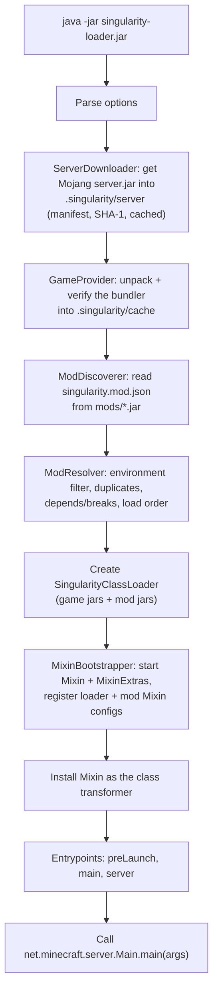

# How Singularity Loader works

## Start-up sequence



Everything before step J happens in the first few hundred milliseconds. After step J the game runs
exactly as it would without a loader, except that every class it loads goes through Mixin.

## Class loaders

```
bootstrap / platform loader     JDK
        ^
application loader              singularity-loader.jar + lib/: loader, API, Mixin, MixinExtras, ASM, Gson
        ^
SingularityClassLoader          Minecraft jar, Minecraft's libraries, mod jars      <- child first
```

* **Child first:** Minecraft's own libraries (Gson, Guava, log4j, Netty...) are used as shipped; the
  loader's private copy of Gson is never visible to the game or to mods.
* **Parent first** for the JDK and for `net.singularitymc.api.`, `net.singularitymc.loader.`,
  `org.spongepowered.asm.`, `org.objectweb.asm.` and `com.llamalad7.mixinextras.`, so that the
  loader, Mixin and every mod see one single copy of these classes.
* Resources (`getResource`, `META-INF/services`, ...) follow the same rule.
* Jars are opened once and kept open (with multi-release support) instead of once per class.

## Mixin integration

Mixin needs a *service* that tells it how to talk to the surrounding launcher.
`SingularityMixinService` provides that:

| Mixin asks for | Answer |
|---|---|
| class bytes of a class | read from the class loader's sources, no other transformers exist |
| load a class | `Class.forName(name, init, SingularityClassLoader)` |
| "is this class already loaded?" | `findLoadedClass` on the game class loader |
| "this class is a Mixin, never load it" | recorded; loading it throws `ClassNotFoundException` |
| logger | the loader's logger (`[Mixin/INFO]` lines) |
| property store | an in-memory map (`SingularityPropertyService`) |

Mixin finds the service through `META-INF/services/org.spongepowered.asm.service.*` in the loader jar.
It hands the loader an `IMixinTransformer` (through `offer`); the class loader calls
`transformClassBytes` for every class right before `defineClass`.

## Getting the server jar

`ServerDownloader` asks Mojang's public version manifest (`piston-meta.mojang.com`) for the version JSON, reads
`downloads.server` (URL, size, SHA-1), downloads the jar to `.singularity/server/<version>/server.jar` and stores its
SHA-1 next to it. On later starts the cached file is re-hashed and reused without any network access. An explicit
`--singularity-server-jar` skips all of this, and if the network is unavailable the loader falls back to a server
already present in the folder.

## Why the server jar is unpacked

Mojang's `server.jar` is a "bundler": a tiny launcher that contains the real server and its libraries.
Running it as is would start the game in a class loader we do not control. `GameProvider` performs
the bundler's job itself (extract, verify SHA-256), then puts the game and its libraries into
`SingularityClassLoader`. Extracted files live in `.singularity/cache/bundle/<version>-<hash>/` and are reused.

## Source layout

| Package | Contents |
|---|---|
| `net.singularitymc.api` | Public API: `SingularityLoader`, mod/version/entrypoint types. Stable. |
| `net.singularitymc.loader` | `Main`, `LoaderImpl` |
| `...loader.launch` | option parsing, the start-up sequence, class dumper |
| `...loader.game` | server jar / bundler handling |
| `...loader.mod` | `singularity.mod.json` parser, discovery, resolver, entrypoints |
| `...loader.classloading` | the game class loader and its class sources |
| `...loader.mixin` | Mixin service, logger, bootstrap |
| `...loader.patches` | Mixins shipped by the loader itself (server brand, crowd / AI / villager / item / XP-orb optimisations, see `PERFORMANCE.md`; switches in `util.PatchSettings`) |
| `...loader.util` | logging |

## Known limitations (0.1)

* Dedicated server only. The client needs a different launch path (assets, natives, authentication).
* No jar-in-jar (mods cannot embed other mods yet).
* Mods are not sandboxed: they run with the same permissions as the server.
* No access wideners / class tweakers; use Mixin `@Accessor` / `@Invoker` instead.
