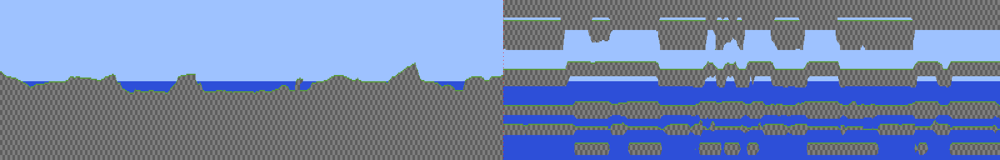
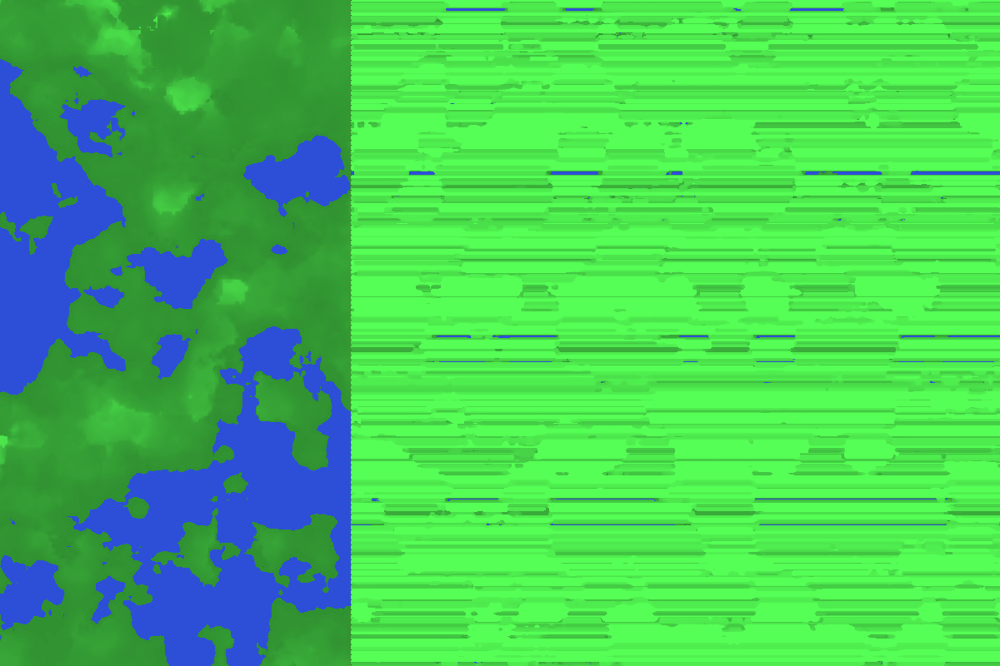
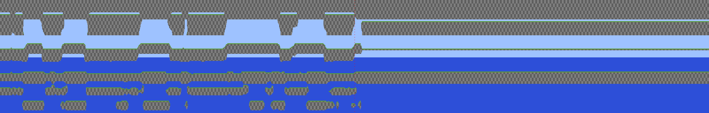
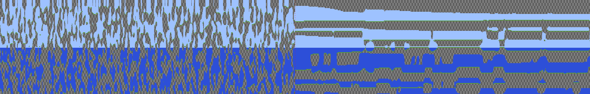
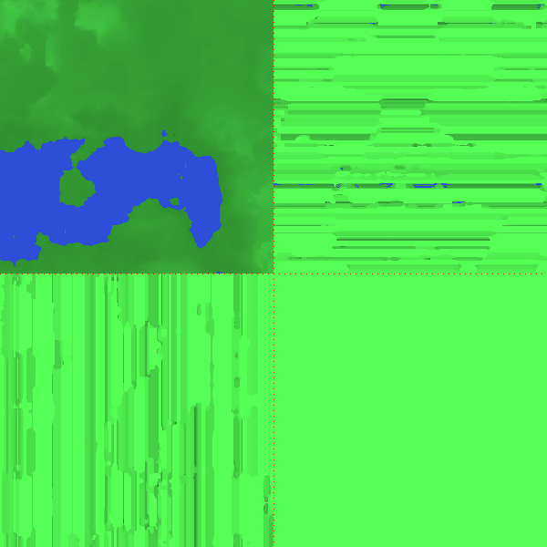
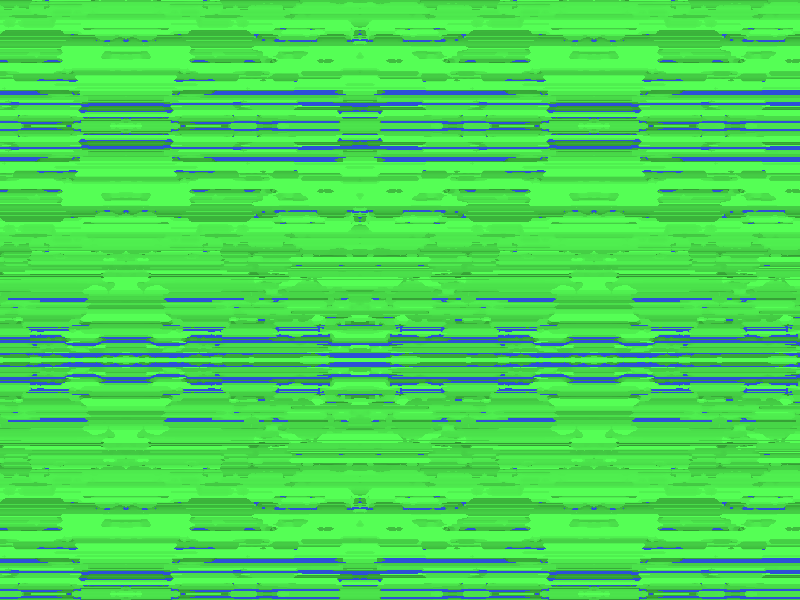
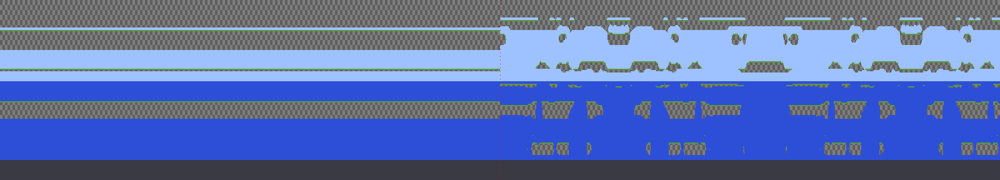
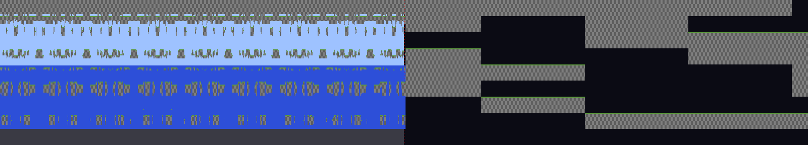
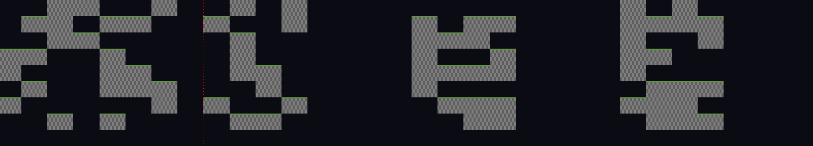

# The Far Lands

`ServerConfig.toml`, section `[singularity]`:

| Key | Default | Meaning |
|---|---|---|
| `enable_farlands` | `true` | Far Lands on or off. Only chunks generated after the change are affected. |
| `farlands_style` | `"classic"` | `"classic"`: the real Far Lands (below). `"mojang"`: Mojang's debug switch (26.3+). |

## Classic (default)
From **12,550,821** blocks out (chunk 784,426 / -784,427, on X or Z) the terrain is generated by a port of Beta 1.7.3's
generator (`util/ClassicFarLands`), with its overflow intact:

*Side view along X at Z = 0 (seed 1234, Y 0-127). The red dotted line is x = 12,550,821.*

*Top view, brighter = higher. Left of the line: ordinary Beta terrain. Right: the Far Lands, stretched along X.*

How it works: Beta's 16-octave "limit" noises sample at `cell * 684.412`. Past cell 3,137,706 (block 12,550,821) that
exceeds 2^31, the `(int)` floor in the Perlin noise saturates, and the remaining "fraction" is huge. Its smoothstep
explodes, so the density swings between enormous positive and negative values: the walls, the long tunnels and the
flooded gaps. The port keeps Beta's seeding (`java.util.Random(seed)`, same noise order), its 5 x 17 x 5 density
field with 4 x 8 x 4 interpolation, and its y-cell gradient caching quirk.

In the game (`patches/ClassicFarLandsMixin`): right after the noise step fills a chunk, and before the surface rules,
Far Lands chunks are refilled between Y 0 and 127 (stone, air, water below sea level); above that is air, below Y 0
the modern deepslate layer stays. Everything after it is modern: biomes, grass and sand, caves and ravines, ores,
trees. Only dimensions whose default fluid is water (the overworld).

Differences from Beta: one plains-like climate instead of Beta's temperature/humidity map; no Beta biomes, sand or
gravel beaches; structures are still placed by the modern height estimate, so some may float or sit inside walls.

Checked: unit tests (`ClassicFarLandsTest`), and a live 26.3 server (seed 1234) where 50 sampled blocks in a Far Lands
chunk matched the generator's prediction (20 stone, 20 air, 10 water) and the area above Y 128 was cleared.

## The stages
Each stage is the same overflow reaching another of Beta's noises, so they all appear by themselves, at Beta's
distances (on X, on Z, or both for the corner versions):

| Stage | From | In this world |
|---|---|---|
| Edge Far Lands | 12,550,821 | Yes. The 16-octave limit noises overflow: walls, long tunnels along the axis, flooded gaps. |
| Corner Far Lands | 12,550,821 on X and Z | Yes. Huge flat slabs in layers, with pillars. |
| Edge Farther Lands | 1,004,065,811 | Yes, with `max_coordinate` above it (up to 1,073,737,728). The 8-octave selector noise overflows too: perfectly flat, unbroken layers. |
| Corner Farther Lands | 1,004,065,811 on X and Z | Yes. |
| 32-bit limit | 2,147,483,647 | No: the world stops at 1,073,737,728 (docs/COORDINATES.md). |
| Chunk overwrite, Stripe Lands, Fartherer, Farthest Lands, 64-bit limit | 34,359,738,368 and up | No: these need block coordinates beyond a 32-bit int, which Minecraft's positions, chunks, saves and network do not have. |

*Edge Farther Lands (side view along X; red line: 1,004,065,811). Left: Far Lands. Right: Farther Lands.*

*Side view at Z = 12,551,021, across X = 12,550,821. Left: the Edge Far Lands wall seen face-on. Right: Corner Far Lands.*

*Top view around the corner at (12,550,821, 12,550,821): normal terrain, the X edge, the Z edge, and the corner.*

The patterns repeat: in the overflow, the terrain hardly depends on the distance along the axis any more, and that
is how Beta's Far Lands look too.

Checked live (26.3 server, seed 1234): 50 of 50 sampled blocks matched the generator at the Edge Far Lands
(x = 12,552,000) and at the Edge Farther Lands (x = 1,004,066,000); a Corner Far Lands chunk generated without errors.

## The virtual 64-bit world
Real block coordinates stop at 2^31 (positions, chunks, saves and the network are 32-bit, and entity doubles lose
whole blocks past 2^53), so a true 64-bit world is not possible. Instead, 64-bit places are visited through
**windows** (`util/VirtualWindows`):

- `/vtp <x> <z>` (operators): 64-bit coordinates, -9,223,372,036,854,775,808 to 9,223,372,036,854,775,807. Inside
  `max_coordinate` it is a normal teleport; beyond, it opens (or reuses) the window around that place and puts you there
  at Y 140.
- `/vpos`: your virtual position and stage. Inside a window the action bar shows it every second (F3 shows the real one).
- A window is a 16,777,216-block square of 64-bit space, shown in a reserved real square of the same size in the far
  -X/-Z corner of the world. Walking inside it is seamless; leaving it puts you back in the real world.
- Windows are saved in `singularity-virtual-windows.txt` in the world folder. They need `max_coordinate` of at least
  50,331,648 and the client mod (the real squares are past 30M). Up to ~1,900 windows with the default cap,
  ~8,000 with `full_int_range`.

### Stages 3 to 6
Beta never got past the 32-bit world, so these stages model the overflow that would come next (`util/FarLandsStages`):

| Stage | From (X or Z) | Terrain |
|---|---|---|
| 3 Gridded Lands | 8,589,934,592 | The sample offset overflows: coordinates fold into a mirrored 234-block period. The Edge Far Lands, sampled along X and along Z, cut each other into a repeating mirrored lattice. |
| 4 Fartherer Lands | 53,905,378,846,980 | Interpolation fails: the density is read once per 1,024-block cell and 16-block layer. Floating rectangular slabs, no water, void below Y 0. |
| 5 Striped Fartherer Lands | 144,115,188,075,855,872 | The slabs, cut by 4,096-block void stripes along the far axis. |
| 6 Final Fringelands | 9,223,372,036,854,000,000 | Nothing: every block is air, down to the bottom of the world. |

Stages 1 and 2 (Far, Farther) continue past 2^31 in windows with the same Beta generator on 64-bit chunks. Biomes,
grass, caves, ores, trees, water springs and dripstone still decorate everything that is generated.

*Gridded Lands, top view: the mirrored repeat every 234 blocks.*

*Side view across 8,589,934,592: Farther Lands layers (left) snap into the gridded architecture.*

*Across 53,905,378,846,980 (5 blocks per pixel): floating slabs over the void.*

*Around 144,115,188,075,855,872 (20 blocks per pixel): 4,096-block void stripes.*

*Across 9,223,372,036,854,000,000: nothing left.*

Checked live (26.3 server, seed 1234): one window per stage (Farther, Gridded, Fartherer, Striped, Fringelands, the last
one ending exactly at 2^63 - 1); 123 sampled blocks, 121 exactly as generated, the other two decorated by vanilla
afterwards (a water spring, pointed dripstone); the void below Y 0 confirmed from stage 4 on. `/vtp` and `/vpos` are
registered and take the full 64-bit range.

## Mojang
Mojang's `SharedConstants.DEBUG_ENABLE_FARLANDS` (26.3+) turns off `GradientNoise.wrap` for every noise at once:
terrain, biomes, caves and aquifers all overflow together. The terrain density becomes infinite or NaN, which reads as
"no solid block", and the aquifers fill the empty world with water and lava. Kept as an option for comparison.

## Singleplayer
The Far Lands are generated by the server. The Singularity Wide Client mod does not include them (yet), so
singleplayer worlds keep vanilla terrain there.
